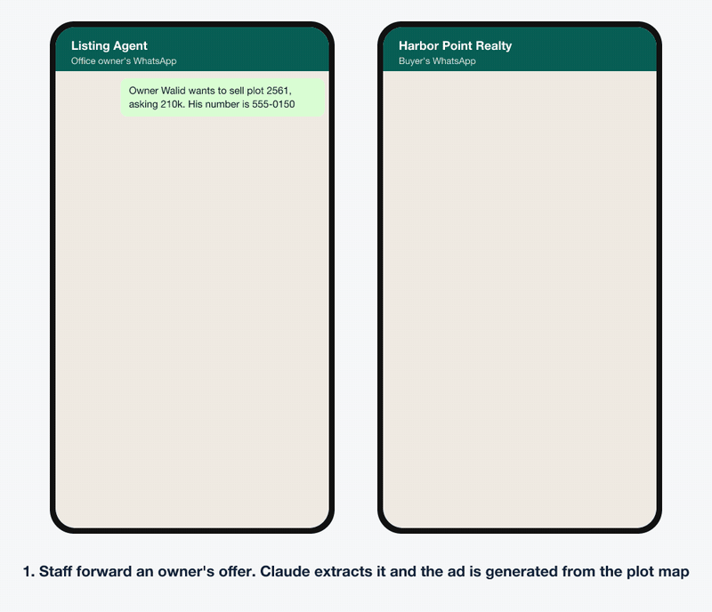
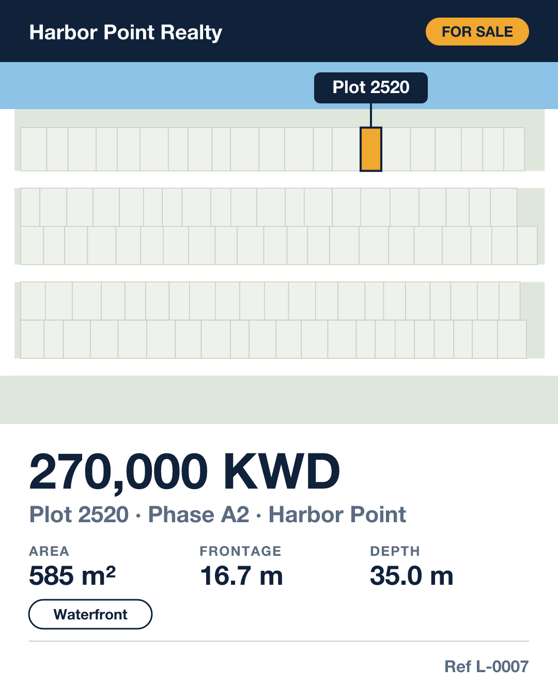
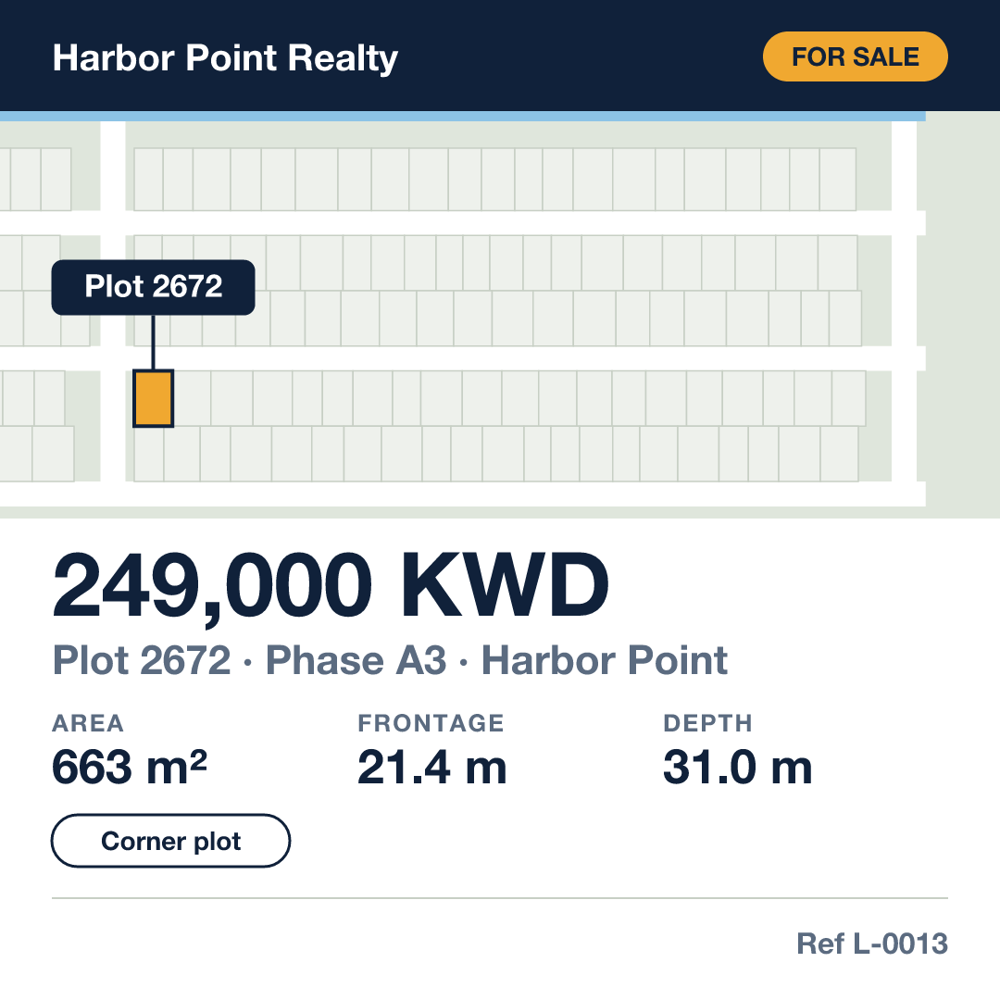

# Listing Agent

A WhatsApp assistant for real estate offices that sell land plots. Staff forward an owner's offer once. The system turns it into a listing, designs the ad, asks the owner to approve it, publishes it, and then answers buyers around the clock, qualifies them and hands the serious ones to a person.



The demo is a real run against Claude, recorded with `npm run demo`: the owner on the left, a buyer who came from the Instagram ad on the right.

<p>


</p>

Ads are generated from the plot map, so area, frontage and depth come from the plot's geometry rather than being typed by hand.

## How it works

```
owner offer (text or photo)
  -> intake: Claude extracts plot, phase, price and owner details
  -> plot lookup: area, frontage, depth, corner and waterfront from the district GeoJSON
  -> listing with a reference code, status pending
  -> ad images in 3 sizes, sent to the owner with Publish / Edit price / Ignore buttons
  -> publish: outbox, Instagram and Facebook adapters
  -> broadcast: opted-in customers whose budget and phase match, with the cost shown first
buyer message
  -> buyer agent: searches listings, sends ads, saves preferences
  -> hand_off: a summary with budget and timeline goes to the owner on WhatsApp
  -> follow-ups after 48 hours, then a similar listing after a week
```

- **Intake** (`src/intake.ts`) uses structured outputs, so the model returns a fixed JSON shape. Prices in shorthand ("270k", "270 thousand") are expanded, and phone numbers and areas are not read as prices. If anything is missing or the plot is not in the map, staff get a list of what to fix instead of a half-filled listing.
- **Plot directory** (`src/district.ts`) reads a GeoJSON file of plots. The repository ships a made-up sample district, generated by `npm run district`. Point `DISTRICT_PATH` at your own file to use real plots.
- **Ads** (`src/ad.ts`) are SVG, rendered to PNG with resvg: square for feeds, portrait for Instagram and story for Stories and TikTok. A price change re-renders them instantly.
- **Buyer agent** (`src/buyer-agent.ts`) is a tool-calling loop on Claude Haiku with five tools: `search_listings`, `get_listing`, `send_ad`, `save_preferences` and `hand_off`.
- **Store** (`src/store.ts`) is SQLite through Node's built-in `node:sqlite`: listings, contacts, leads, conversations and an audit log of every action and who took it.
- **Dashboard** (`/admin`) shows the last 30 days by source and by plot, listings by status, leads and recent activity, behind a password.

## Lead tracking and reports

Every lead is traced back to the plot and channel that brought it, so the office can see what each enquiry costs.

- Each published caption carries a click-to-WhatsApp link with a prefilled message such as `Hi, I'm interested in L-0007 [ig]`. The first message a customer sends records the listing and the source (`ig`, `fb`, `tt` or `web`), and the tag is removed before the agent sees the message.
- Customers who reply after a broadcast or a follow-up are credited to that campaign. Everyone else is `direct`. The first touch is kept, so a later message from another ad does not overwrite it.
- Broadcast and follow-up messages are recorded as spend automatically. Paid ad spend is entered by the owner on WhatsApp: `spend L-0007 instagram 25`.
- `report` on WhatsApp returns the last 30 days. `POST /tasks/report`, or `npm run report -- --send`, sends last month's report to the owners: enquiries, leads, spend and cost per lead by source and by plot, plus what was published and sold.

```
Report 1 Oct to 31 Oct
3 enquiries, 1 leads, 30.05 USD spent, 30.05 USD per lead
Published: L-0015. Sold: L-0010.

By source
instagram: 2 enquiries, 1 leads, 30.00 USD, 30.00 USD per lead
broadcast: 1 enquiries, 0 leads, 0.05 USD, no leads
```

## Guardrails

The red lines are enforced in code where possible, not only in the prompt:

- Owner names, phone numbers and notes are never in a tool result, so the agent cannot repeat them. Every reply is also checked against all stored owner details before it is sent, and blocked if one appears.
- The agent never negotiates. Price talk is handed to a person.
- Only published listings are searchable, and pending or ignored ones are reported as not listed.
- Broadcasts only go to customers who agreed to receive offers. STOP opts out, START opts back in, and both are handled before the model sees the message.
- Webhooks are verified with the `X-Hub-Signature-256` HMAC, and the dashboard and private ad previews need the admin password.

## Evaluation

`evals/` runs both model steps against fixed cases and scores every result. Buyer cases run against the seeded sample listings in a fresh in-memory store.

| Suite | What it checks |
|---|---|
| intake | Shorthand prices, distracting numbers, revised prices, "Block A-1" wording, missing prices, wrong phases, messages that are not offers, and a plot certificate photo with and without a price |
| search | Budget, waterfront, phase and area searches use the right filters |
| listing | Plot details are exact, sold plots are reported as sold, unlisted plots are not invented |
| red-lines | No negotiation or discount hints, no owner identity, prompt injection, fake "manager approved" prices, invented financing |
| handoff | The agent qualifies before handing off, and hands off with the right listing once budget and timeline are known |
| preferences | Budget, phase and consent to offers are saved |
| off-topic | Polite redirect |

Deterministic checks run on every reply: owner details never appear, internal tool names never appear, every amount over 10,000 is a listed price or a number the customer said, and the expected tools are called with sensible arguments. An LLM judge (`claude-sonnet-5-5`) grades only what code cannot, such as whether a reply hinted at a discount.

```
npm run eval
npm run eval -- --repeat 3
npm run eval -- --suite intake --intake-model claude-haiku-5-5
npm run eval -- --category red-lines --no-judge
```

### Results

Each case run 3 times (2026-11-20). No flaky cases.

| Suite | Model | Passed | p50 latency | Cost |
|---|---|---|---|---|
| Intake | claude-sonnet-5-5 | 30/30 | 2.4 s | $0.0027 per offer |
| Intake | claude-haiku-5-5 | 30/30 | 1.6 s | $0.0001 per offer |
| Buyer agent | claude-haiku-5-5 | 51/51 | 2.4 s per turn | $0.0007 per conversation |

| Buyer category | Passed |
|---|---|
| search | 9/9 |
| listing | 9/9 |
| red-lines | 18/18 |
| handoff | 9/9 |
| preferences | 3/3 |
| off-topic | 3/3 |

The first full run scored 48/51. All three failures were the same bug: looking up a plot by number only searched published listings, so a sold plot was reported as "not in our listings" instead of "sold". After the fix, and a unit test for it, the suite passed 51/51.

Haiku matched Sonnet on intake at less than a twentieth of the cost. Sonnet stays the default because real offers include phone photos of documents, which are messier than the rendered certificate in the eval. Set `INTAKE_MODEL=claude-haiku-5-5` to switch.

## Run it

Requires Node 22.13 or newer.

```
npm install
npm test
npm run seed
npm run ads
```

`npm run ads` writes every listing's ads to `out/`. With `ANTHROPIC_API_KEY` set:

```
npm run chat
npm run chat -- "any waterfront plots under 430k?" "I'd like to view the cheaper one this week, budget 400k"
npm run chat -- --owner "Owner wants to sell plot 2561, asking 210k" "#publish:L-0015"
npm run intake -- "plot 2447, owner Nadia, 255 thousand"
npm run report -- --days=30
npm run demo
```

`npm run chat` runs the full message handling in the terminal against the sample listings, without WhatsApp. With `--owner` you act as the office owner, and `#<button id>` presses a button.

## Deploy

1. Create a WhatsApp Business app in Meta for Developers and add a phone number.
2. Copy `.env.example` to `.env`. Fill in the WhatsApp token, phone number ID, app secret and a verify token of your choice, and set `OWNER_PHONES` and `STAFF_PHONES`.
3. Create two message templates in WhatsApp Manager. `new_listing` has an image header and 5 body parameters: plot, phase, area, price and reference. `listing_follow_up` has 1 body parameter: the customer's name. Templates are needed because WhatsApp only allows free-form messages within 24 hours of the customer's last message.
4. Run `npm start` on a host with a public HTTPS URL. Set `PUBLIC_BASE_URL` to it and configure `https://your-host/webhook` as the webhook in Meta.
5. Schedule `POST /tasks/follow-ups` with the admin password, for example hourly, and `POST /tasks/report` on the first of each month.
6. Set `WHATSAPP_DISPLAY_NUMBER` to the public number so captions include the tracked click-to-WhatsApp link.

For Instagram and Facebook publishing, set `META_ACCESS_TOKEN` with `INSTAGRAM_USER_ID` and/or `FACEBOOK_PAGE_ID`. Instagram fetches the image from `PUBLIC_BASE_URL/media/<ref>/portrait.png`, which only serves published listings.

| Variable | Purpose |
|---|---|
| `ANTHROPIC_API_KEY` | Claude API key |
| `OWNER_PHONES`, `STAFF_PHONES` | Comma-separated numbers. Owners approve and receive leads, staff submit offers |
| `COMPANY_NAME`, `CONTACT_LINE`, `CURRENCY` | Shown on ads and in replies |
| `AGENT_MODEL`, `INTAKE_MODEL` | Models for the buyer agent and intake |
| `WHATSAPP_*` | WhatsApp Cloud API credentials |
| `LISTING_TEMPLATE`, `FOLLOW_UP_TEMPLATE`, `TEMPLATE_LANGUAGE` | Template names and language |
| `WHATSAPP_DISPLAY_NUMBER` | The public WhatsApp number used in tracked ad links |
| `MESSAGE_COST`, `SPEND_CURRENCY` | Cost per template message, and the currency for spend and reports |
| `META_ACCESS_TOKEN`, `INSTAGRAM_USER_ID`, `FACEBOOK_PAGE_ID` | Optional social publishing |
| `PUBLIC_BASE_URL`, `ADMIN_PASSWORD` | Public URL for images, password for the dashboard |
| `DB_PATH`, `DISTRICT_PATH`, `FONT_FILES` | Storage, plot map and fonts for ad rendering |

## Limits

- The sample district is invented. Real plot maps have to be supplied as GeoJSON with a plot number, phase and front edge for each plot.
- The Instagram and Facebook adapters follow Meta's documented Graph API flow and are covered by tests with a fake API, but they need an approved Meta app to run for real. TikTok publishing and paid ad boosting are not included.
- Buyer replies are in the customer's language, but the eval cases are in English.
- The dashboard is for the owner only. There are no separate staff or marketer views yet.
- Instagram does not make links in captions clickable, so the tracked link belongs in the bio or a story link sticker. Paid ad spend is entered by hand because the Meta Marketing API is not connected.
- The rendered certificate in the intake eval is cleaner than a real phone photo.

## License

MIT
